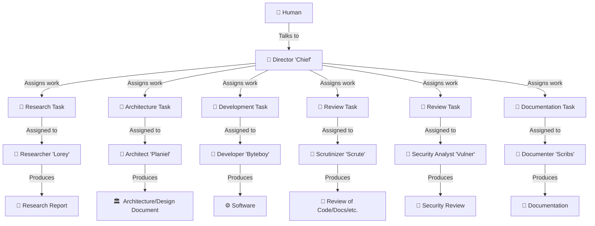

# Devbots

Devbots is a team of agents whose job is to design and implement high-quality software.
Each agent plays a unique role in the software development process; all of them work with the human through the **Director** agent.

It requires Python 3.10+ on Windows or Linux.

**What this plugin is *not***:

This plugin does *not* provide language-specific tools, nor language-specific or project-specific instructions.

Devbots provides a team of agents (and a set of Python skills used by those agents) that document their work, coordinate tasks with one another, and work with the human to deliver software.
The agents themselves are instructed to use other tools at their disposal, so make sure to pair this plugin with other tools (MCP, local skills, other plugins, etc.) that will provide them with all the project-specific tools you need!

## The Team

* 📣 [The Director](./agents/director.agent.md) ("**Chief**") - Talks with the human; manages and delegates all other agents.
* 📐 [The Architect](./agents/architect.agent.md) ("**Planiel**") - Plans out system design and architecture.
* 🏗️ [The Developer](./agents/developer.agent.md) ("**Byteboy**") - Writes the code.
* 📝 [The Documenter](./agents/documenter.agent.md) ("**Scribs**") - Writes documentation.
* 📚 [The Researcher](./agents/researcher.agent.md) ("**Lorey**") - Researchers new and unknown topics to inform decisions.
* 🔍 [The Scrutinizer](./agents/scrutinizer.agent.md) ("**Scrute**") - Reviews code, system designs, documentation, etc., for quality.
* 🛡️ [The Security Analyst](./agents/secanalyst.agent.md) ("**Vulner**") - Reviews code, system designs, documentation, etc., for security.



## Using Devbots

```bash
# Run the unit tests
python3 -m unittest discover -s tests

# Install the agents and skills to your local `~/.copilot`
python3 install.py

# Install somewhere else
python3 install.py --destination "./path/to/your/custom/location"
```

Use `python3 install.py --no-overwrite` to avoid overwriting already-installed files.

Type `/agent` and select `[Devbots::Director] Chief`.
Then, describe the work you'd like to do.
Chief will create tasks and delegate work, and communicate with you throughout the development process.

## Agents Track Their Work

The tools included in this plugin provide the devbots with the ability to create and manage their work in a `.devbots/` working directory.
This directory is used to create **tasks** and **reports**, among other things.

A working directory used by the devbots may look something like this:

```
.devbots/
├── reports
│   ├── 09d92d0bd2df9a41.report.md
│   ├── a335715f6585175d.report.md
│   ├── dcaf64bddb700dec.report.md
│   └── e982e0bc43151f9a.report.md
└── tasks
    ├── 06b37fa496d0bc38.task.md
    ├── 0e15a96b9f263e1a.task.md
    ├── 10bbf9056f570b5f.task.md
    ├── 140e5608f794b115.task.md
    ├── 152b33c6c8116c35.task.md
...
```

### Task Files

Files ending with `*.task.md` describe individual items of work that need doing by the devbots.
Task files contain:

* A description of the task
* Ongoing discussion among the devbots about the task
* Metadata, such as:
    * The author (who created the task)
    * The owner (which agent is working on the task)
    * The status (`done`, `pending`, `underway`, etc.)
    * And more!

The devbots can use the task CLI tool to create, update, and query for these tasks.

<details>
<summary>(Click to Expand - Example Task File)</summary>

```markdown
---
{
  "id": "140e5608f794b115",
  "title": "Implement the feature",
  "author": "Chief",
  "created": "2026-11-12T20:00:00.000000+00:00",
  "updated": "2026-11-12T21:00:00.000000+00:00",
  "status": "done",
  "owner": "Byteboy",
  "linked_tasks": []
}
---

<!-- devbots-section: 30 -->
Implement the approved design.

<!-- devbots-section: 58 -->
## 2026-11-12T21:00:00.000000+00:00 - Byteboy

Tests pass.

```

</details>

### Report Files

Files ending with `*.report.md` contain reports written by the devbots.
Reports are used for a variety of purposes, such as:

* System design reports (from the Architect)
* Code review reports (from the Scrutinizer or the Security Analyst)
* Research reports (from the Researcher)
* Bug investigation reports

<details>
<summary>(Click to Expand - Example Report File)</summary>

```markdown
---
{
  "id": "229adc97c58467e1",
  "title": "Feature validation",
  "author": "Scrute",
  "created": "2026-11-12T21:00:00.000000+00:00",
  "updated": "2026-11-12T21:00:00.000000+00:00"
}
---

# Review Report

## Summary

Focused tests passed. No blocking findings.
```

</details>

## Output

When working with these agents, you can expect to see output prefixed with various emojis:

* Output prefixed with `📣` indicates information from the Director.
* Output prefixed with `📐` indicates information from the Architect.
* Output prefixed with `🏗️` indicates information from the Developer.
* Output prefixed with `📝` indicates information from the Documenter.
* Output prefixed with `📚` indicates information from the Researcher.
* Output prefixed with `🔍` indicates information from the Scrutinizer.
* Output prefixed with `🛡️` indicates information from the Security Analyst.
